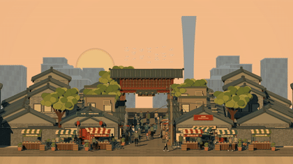
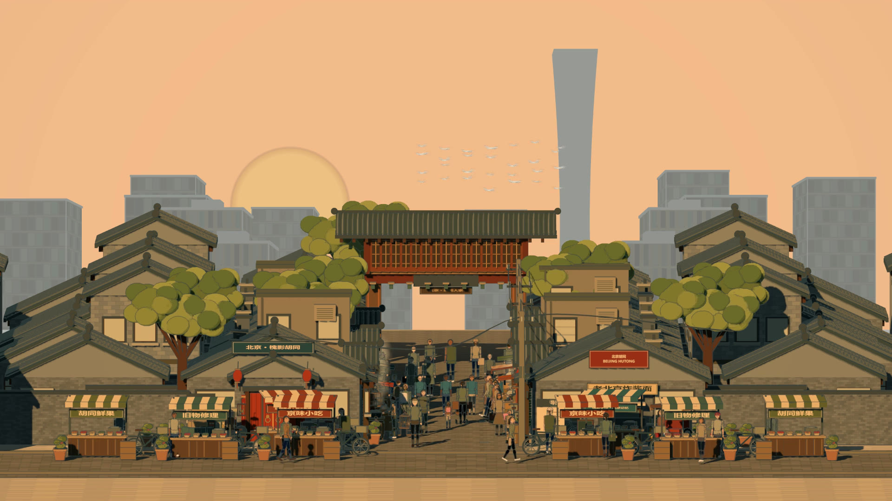
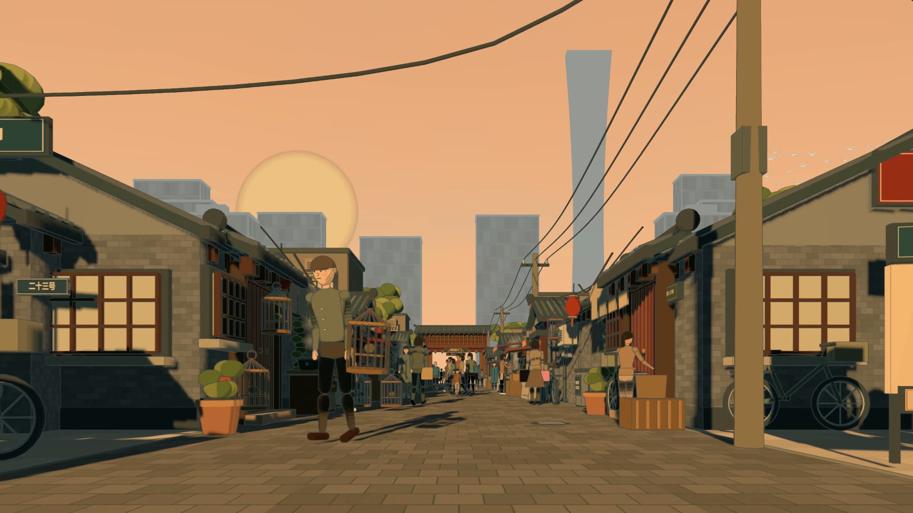

# 透视错觉 perspective-illusion（中文改版）

> 本仓库是 dotslashsimran 的 perspective-illusion 技能的中文改版（原仓库：https://github.com/dotslashsimran/simcraft ）。文档翻译为中文并加了小白说明，画风改为柔和插画，渲染脚本修了几个坑。用这个技能做出的作品为使用者本人原创，工具来源如上。

---

## 一、这是什么

**一句话：你说一个地方，AI 把它写成一个 3D 场景，然后像拍片一样把它"录"成一条无缝循环的动画短片。**

片子的招牌效果：

- 画面一开始是**扁的**，像一张平面插画；
- 镜头一动，画面**打开成立体的**，纵深一下拉开；
- 趁画面扁着的时候，里面的东西会**悄悄换位置**，打开之后你才发现排列变了；
- 最后严丝合缝**回到第一帧**，可以无限循环。



下面两张图是同一个场景：





**它不是 AI 生图，也不是 AI 生视频。** 全部画面都是代码在浏览器里一帧一帧算出来的，所以不用显卡、不花生成积分，画面里的文字永远不会写错，同一个文件渲多少次都一模一样。代价是慢：它更像"让 AI 搭一个微缩舞台，再用摄影机拍下来"，出片要等（时间账见第四节）。

---

## 二、怎么安装

**装法只有一个动作：把这个仓库的地址发给模型，让它自己装。**

仓库地址：`https://github.com/huzhengjing/perspective-illusion-zh`

把下面这句话连同地址一起发给它：

```
请打开这个仓库，读里面的 SKILL.md，把这个技能安装好，装完告诉我。
```

能自己动手的模型会自己下载文件、放好位置、检查缺什么软件，你不用手动放任何文件（技能需要的原仓库模板素材，它读了 SKILL.md 会自己一并下载）。它装完会向你报告，然后你就可以直接说想做什么地方了。

**能不能这样装，取决于你用的模型有没有"手"：**

- **桌面版 / 带终端的模型（推荐）**：ChatGPT 桌面版（Codex 模式）、Claude Code、DeepSeek 的桌面端 Harness、自带云端电脑的聊天客户端（如 Muse）——都能给地址自装，全程不用你管；
- **网页版里带虚拟电脑的智能体模式**：比如 Kimi 的 OK Computer 模式，它在云端有自己的一台电脑（有终端、文件和浏览器），同样可以给地址让它自装。提醒一句：正式版渲染要连续跑几十分钟，这个模式能不能扛完我们没实测过，出静帧和预览没问题；
- **普通网页版**：豆包、DeepSeek、通义千问的日常对话网页版都属于这类——它们只会出文字，没有手，装不了技能，也渲不了片子。但动脑的活可以让它们干：读技能、给生图提示词、写场景代码，最后渲染那一步转到上面两类模型完成。顺带说清：豆包、即梦网页版能"生成视频"，那是 AI 生视频，是另一条技术路线，和这个用代码渲染的技能不是一回事，别混。

**兜底**：万一你的模型装不上，或者你想自己手动装，完整的手动步骤在仓库的《使用说明.md》里，照着做即可。

---

## 三、怎么用

两种方式，先想好走哪条：**有参考图的方式一**（效果可控，推荐）和**直接搭的方式二**（省事，先试水）。

### 方式一：先出参考图，再照着搭

适合你心里对画面有明确想法的场合。流程是"图先定，场景照着图长"：

1. 对装了技能的模型说：**"我要做 XX（地方），走方式一。"**
2. 它先给你**一条生图提示词**——这条提示词是工具中立的，哪个生图工具都能用；
3. **拿提示词去生第一张图（平面图）。** 注意：装技能的模型不一定会出图，比如 Codex 模式就不会。这时换一个能出图的模型或工具去生（Midjourney、Grok、即梦……都行），生到满意为止。第一张图定的是：画面的长相、画风、颜色、时段；
4. 第一张满意后，**拿它再去推第二张图（纵深图）**：同一个地方"打开"之后的样子。这张图只管一件事——告诉模型打开之后纵深怎么分层、东西摆多密，它的画风不用管；
5. **把两张图一起发回给装技能的模型。** 它会先报一版布局（地方多宽多深、地标摆在哪、离镜头多远，都是数字），你确认没问题，它再照着两张图搭场景；
6. 然后进入共同的后半程：渲静帧 → 你看图提意见、改 → 渲预览看节奏 → 正式版（为什么是这个顺序，见第四节）。

### 方式二：不出图，直接搭

适合先快速试一版、或者你对画面没有具体预设：

1. 直接说需求：一句话讲清**什么地方、什么时间、什么天气、要什么感觉**，例如"做一条北京胡同的循环片，傍晚，9 秒"；
2. 模型把需求拆成场景清单，写成场景代码；
3. 它把每个机位渲成**编号静帧图**发你；
4. **你看图拍板**：指出哪里不对、哪里不像，并报编号挑镜头（比如"1、2、4、7"），挑中的顺序就是片子的镜头顺序——这一步不要让 AI 自己定，它的排序节奏往往不对；
5. 按你的意见改，静帧过关后渲预览，你看节奏和衔接；
6. 节奏对了，渲正式版，完工。

**两种方式的成品没有区别**，区别只是画面有没有一张参考图当锚：方式一返工少，方式二起步快。

---

## 四、为什么先出静帧，再出视频

这是这个技能最重要的一条工作习惯，原因有三：

1. **时间差太多。** 渲一批静帧只要 2~4 分钟，改一版再看也就几分钟；而正式版视频渲一条要 30~50 分钟。构图错了，在静帧阶段发现，代价是几分钟；在成片里发现，代价是大半个小时加全部重来。
2. **静帧就是成片的真画面。** 场景里所有动画都是按时间算好的，某个时刻的静帧，就是成片里那一帧的样子，不存在"静帧好看、成片变样"。所以静帧过关，构图、内容、颜色就等于过关了。
3. **分工清楚。** 静帧阶段定"长什么样"，预览阶段定"动起来顺不顺"（走路姿势、换位过程、镜头衔接，这些静帧看不出来），正式版只是最后把定好的东西完整录一遍。顺序反了，就是拿最贵的一步去试最便宜的问题。

---

## 五、作品展示：《北京胡同》是怎么做出来的

这条片子走的就是**方式一**，全过程四张图：

**第 1 步：生图提示词出的第一张图（平面图）**——定长相、画风和黄昏的色调：


**第 2 步：拿第一张推出来的第二张图（纵深图）**——定打开之后的纵深和人群密度：


**第 3 步：照着两张图搭出的场景，成片平面帧：**


**第 4 步：成片打开帧**——机位钻进巷子，牌楼退到巷子深处：


用同一技能做完的还有：《北京国贸 · 雨夜》（黄昏雨夜的国贸桥，中国尊和央视大楼在楼群后）、《北京中轴线》（天安门 → 端门 → 午门 → 太和殿 → 景山，一条轴线五层叠景）。

---

## 六、常见坑（就三条）

| 现象 | 怎么办 |
|---|---|
| Windows 上渲染特别慢或者没动静 | 渲染脚本里的 `"--use-angle=metal"` 没改成 `"--use-angle=d3d11"`，让模型改一下就行 |
| 渲出来的片子只有 7 秒 | 渲染命令没写时长，脚本按默认值走了。命令里加 `--to=秒数`，比如 10 秒的片子写 `--to=10` |
| 更新技能后渲染出问题 | 你覆盖了改过 Windows 参数的三个渲染脚本。更新只覆盖 `SKILL.md`、`reference.md` 和 `templates/`，渲染脚本别动 |

---

*本仓库为中文改版：原作者 dotslashsimran（simcraft），本版做了文档中文化、柔和插画画风、场景规范补充和渲染脚本修复。更新时不要直接拿原版覆盖本版文件。*
